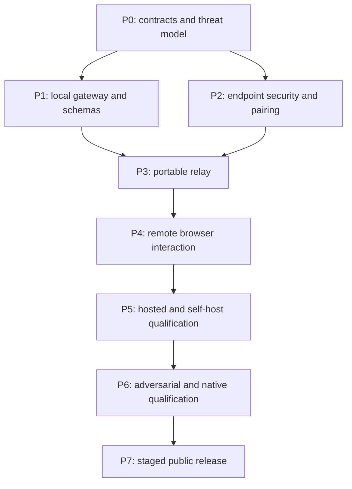

# AX Code remote control implementation plan

Date: 2026-10-17
Status: Proposed work breakdown. No phase is implemented by this report package.

## 1. Delivery contract

Deliver remote supervision and ordinary session interaction through the AX Code desktop app. A phone browser connects through a free hosted application relay or a self-hosted deployment of the same relay artifact. Execution, permissions, queues, snapshots and worktree state stay in the existing local runtime.

Do not make Headscale, a second coding engine, a new AX Agent manager, or a cloud transcript database a prerequisite. Existing local-only runtime listeners remain unchanged. The new desktop gateway is admitted only after its explicit product/security boundary is accepted.

The final public product must support both hosted and self-hosted operation. An early internal pilot can qualify one relay deployment first, but a hosted-only pilot is not completion of this plan.

## 2. Candidate code locations

Paths below are proposed additions, not existing APIs or authorization to create workspaces before D05. Final names must match accepted repository conventions.

| Area                | Existing integration point                                                                              | Proposed work                                                                                                                 |
| ------------------- | ------------------------------------------------------------------------------------------------------- | ----------------------------------------------------------------------------------------------------------------------------- |
| Desktop supervision | `desktop/packages/electron/src/server-process.js`, `axcode-runtime-supervisor.js`, `supervision-fsm.js` | Explicit remote connection-worker lifecycle and bounded status IPC; preserve existing runtime ownership                       |
| Remote adapter      | `desktop/packages/web/server/lib/ax-code/proxy.js`, event-stream runtime                                | A dedicated `remote-control/` adapter exposing semantic operations; no generic proxy widening                                 |
| Browser UI          | `desktop/packages/ui/src/`, sync pipeline and permission/question components                            | Remote browser entry, limited project/session projections, pairing/device settings and pending-request UI                     |
| Shared wire schema  | Existing SDK and endpoint/IPC contract checks                                                           | A small browser-safe protocol package if justified by D05; never import Node/runtime internals into the browser               |
| Relay service       | No current relay service established                                                                    | A portable relay package/service owned by the accepted D05 decision; separate deploy target and image from the desktop binary |
| Product tests       | Existing per-package tests, root script checks and native smoke scripts                                 | Protocol, security, lifecycle and supported-platform acceptance lanes                                                         |
| Runtime producer    | `../ax-code`, only if a contract gap is demonstrated                                                    | Additive schemas/capabilities and canonical receipt/actor binding; publish SDK/runtime before consumer pin updates            |

Existing Electron/web/UI authentication cannot simply be relabeled as remote authorization. Assess each endpoint and ensure the remote adapter cannot access settings, credentials, arbitrary files, terminals, or privileged IPC through a generic fallback.

## 3. Dependency graph

Independent work within a phase may proceed concurrently only under repository isolation rules. Do not parallelize writers into shared files without an isolated worktree or deterministic serialization. This documentation task does not launch implementation agents.

## 4. Phase zero: boundary and contract decisions

### Work

- Inventory the exact current desktop SDK/runtime pair from `config/ax-code-sdk.json`, `config/ax-code-runtime.json`, lockfile and installed artifacts. Record hashes and negotiated capabilities; do not trust historical versions in an ADR.
- Draft a desktop remote-control PRD with hosted and self-hosted requirements, default-off enablement, selected-project scope, personal-device pairing, privacy claims and exclusions.
- Draft a new desktop ADR covering the remote connector, app/runtime lifecycle, narrow gateway, relay ownership and the relationship to accepted portfolio/process decisions. Use the next free ADR number at creation time.
- Draft an AX Code producer ADR/PRD amendment if caller identity, pending-approval binding, receipt lookup, SDK support, or the existing local-only contract needs an additive change. Do not weaken listener validation to avoid this work.
- Evaluate the published SDK for canonical prompt identity, durable acceptance/lookup, follow-up queues, session reads, diff reads, resume cursors, current pending permissions/questions and turn interruption.
- Complete D02 with a maintained cryptographic implementation, interoperability test vectors, browser/native support, forward-secrecy/rekey requirements, key recovery and verified package provenance. A protocol family name is not sufficient.
- Resolve hosted identity availability and self-hosted identity configuration. Inspect actual AX Trust contracts before consuming them; the plan does not assume a new generic identity/grant service exists.
- Choose the relay service owner and package boundary. Prefer one portable implementation and the same artifact for hosted and self-hosted deployments. Define state-store and account-admission adapters without building two unrelated relay backends.
- Define local key storage on macOS, Windows and Linux, including fail-closed behavior where secure storage is unavailable.

### Deliverables and exit

An accepted PRD, new ADRs in affected repositories, versioned behavior/protocol specs, capability gap matrix, dependency review, threat model, ownership matrix and testable acceptance IDs. D01-D07 in the package overview have named owners and dispositions. No production remote endpoint is enabled in this phase.

## 5. P1: local gateway and canonical operation mapping

### Work

- Implement a default-off local adapter that accepts validated semantic messages from a privileged test client, initially using synthetic transports.
- Map opaque project references to locally registered canonical directories/worktrees. Refuse arbitrary path selection, unselected projects, removed projects, changed worktree identity and stale runtime bindings.
- Implement read-only session/progress/diff operations before mutations. Bound payload sizes, output pages and concurrent subscriptions.
- Integrate canonical runtime receipts and stable identities. The gateway may persist a correlation index, but may not become a second execution queue or declare acceptance before the runtime's durable admission.
- Add `prompt:submit`, current approval/question response and active-turn interrupt only after capability checks establish their bindings. Preserve normal permission and isolation behavior.
- Add a transport interface separating message framing, local operation dispatch and UI projection. A network failure never invokes a second execution path.
- Keep the runtime password in the privileged host boundary. Remote caller identity must survive the local adapter's authorization and safe evidence correlation; it must not be inferred from spoofable headers.

### Exit criteria

G01: No remote operation reaches an unselected project or an excluded endpoint.

G02: Read-only grants cannot submit, approve, interrupt, alter configuration or invoke arbitrary tools.

G03: Repeating an accepted submit with the same operation ID/payload resolves to one canonical admission. A different payload under that ID is rejected. A missing canonical guarantee blocks mutation rollout.

G04: Existing local desktop behavior and loopback-only listener tests continue to pass.

## 6. P2: pairing, endpoint encryption and device grants

### Work

- Implement host identity, protected local storage, device keys and pairing as specified by D02/D07. Never migrate private keys through generic project/settings export.
- Create single-use expiring invitations with safe link/QR handling. Bind the relay endpoint, gateway identity, remote key, requested project set and scope preview.
- Require local pairing confirmation and an authenticated endpoint handshake. A cloud login alone does not enroll a device or authorize a local operation.
- Implement grant revisions, expiry, local revocation, live-channel closure, pending-work cancellation and key-possession checks.
- Fence identity changes and duplicated profiles. Host-key changes require explicit trust recovery; reconnect must not silently accept a replacement host.
- Implement production TLS validation and safe custom relay selection. Bind admission credentials to the correct relay audience and origin; prevent credential forwarding through redirects or endpoint changes.

### Exit criteria

G05: Concurrent invitation redemption admits at most one device; expiry/cancellation and wrong-host/endpoint/key cases fail closed.

G06: Revocation prevents future operations and terminates active reads/channels within the accepted bound. Reconnect cannot resurrect a revoked grant.

G07: Standard vectors and cross-runtime interoperability pass. A malicious routing peer cannot substitute keys, replay accepted encrypted frames, or widen a local scope.

G08: Privacy wording correctly states trusted client delivery and metadata exposure; no claim exceeds the tested threat model.

## 7. P3: portable relay and internal end-to-end slice

### Work

- Implement authenticated host registration and browser admission, bounded pre-authentication connections, opaque routing, duplicate-host fencing and connection ownership.
- Route encrypted endpoint frames without parsing project/session content. Enforce frame, queue, stream, account, device and connection limits before allocating unbounded resources.
- Add heartbeat, randomized reconnect backoff, overload responses, cancellation and per-stream flow control. Keep task execution outside the relay.
- Persist only the minimum routing/admission metadata. Keep forwarding buffers transient; no offline mutation queue or transcript persistence in version one.
- Build one versioned relay artifact and a synthetic host/browser integration fixture. Capture protocol/version/error behavior independently of any production service.
- Use independent resources for internal remote-control tests. Do not reuse installer/download workers, release buckets, signing identities or updater routes.

### Exit criteria

G09: Two synthetic accounts cannot discover or route to each other's gateways, attach to their streams or redeem their invitations.

G10: Payload contents and local runtime credentials do not appear in relay storage, diagnostics or logs. Tests verify this with distinctive synthetic markers.

G11: Slow/disconnected peers, flooding, oversized frames and failed handshakes stay within declared resource bounds. Work accepted locally is unaffected by relay outage.

G12: A real phone can connect to an internal test desktop through the relay and view an allowed session without adding a public inbound listener to the development machine.

## 8. P4: remote browser product slice

### Work

- Add a small responsive entry that can pair, reconnect, select from locally allowed projects/sessions, show progress, inspect bounded diffs, submit ordinary prompts and resolve supported pending requests.
- Reuse browser-safe presentation and sync components where compatible. Avoid exposing the complete local Settings UI or an Electron-only runtime registry to the remote client.
- Display execution host/project, connection freshness, queued/accepted/running/unknown/terminal states and exact pending approval targets. Keep stale views visibly read-only.
- Preserve request identity through ambiguous submission retries. Restore current pending requests from the runtime rather than replaying a cached browser approval card.
- Define multi-device behavior: independent drafts, shared authoritative session state, conflict responses for stale mutations, and one resolved result when approval responders race.
- Do not add per-keystroke remote shell, arbitrary attachments, plugin installation or autonomous cross-project dispatch to this slice.

### Exit criteria

G13: Mobile Safari and Chrome complete pairing, view progress/diff, submit a prompt, answer a current approval and interrupt the selected turn.

G14: Browser close, refresh, network handover and expired authentication do not duplicate a mutation or falsely mark a task complete.

G15: Diff/tool output cannot inject HTML, alter displayed approval scope or become protocol instructions. Accessibility and narrow-screen controls remain usable.

## 9. P5: hosted pilot and self-host parity

### Work

- Deploy a private hosted pilot with real authentication, a documented resource envelope, strict account isolation and safe operational metadata. Keep account registration invite-only until abuse and capacity behavior are measured.
- Package the exact same relay artifact for self-hosting with configuration schema, secret-file support, TLS/origin requirements, identity-provider configuration, backup/restore, health checks, upgrades and rollback instructions.
- Verify self-hosted mode on a clean server and browser profile with hosted AX Code routing/identity domains unavailable. Model-provider calls remain independently configured local runtime behavior; do not confuse those with relay independence.
- Require explicit user choice for custom endpoints and any associated issuer/certificate/key change. Reject non-loopback HTTP/WS endpoints in production.
- Set free device/concurrency/traffic limits from measured envelopes and show quota/offline/overload reasons in product UI. Do not advertise unlimited relay bandwidth.

### Exit criteria

G16: Hosted and self-hosted operation pass the same protocol/security/lifecycle tests with a recorded server artifact digest.

G17: Changing relay/account origins does not leak the previous provider's credentials, silently retain stale grants, or route to an old host.

G18: Backup/restore and mixed-version rolling/restart scenarios preserve documented metadata and require re-pairing when key continuity cannot be proven.

## 10. P6: adversarial, reliability and native qualification

Execute the full matrix in [validation and operations](VALIDATION-AND-OPERATIONS.md). Include cross-account probes, rogue relay/key substitution, stale approvals, live revocation, worktree changes, malformed inputs, blocked storage, slow clients, acknowledgement loss, renderer/app/runtime crashes, sleep/wake and sustained mobile use.

Run applicable desktop checks after implementation: `pnpm run typecheck`, `pnpm run lint`, `pnpm run test`, `pnpm run build`, and `pnpm run check:boundaries`. Add focused contract/security tests to the normal package lanes. Run signed packaged smoke on macOS Apple Silicon, Windows x64 and supported Linux targets before describing the feature as supported there.

If runtime/server/OpenAPI contracts change, follow producer tests and SDK generation in the runtime repository, preserve generated artifacts, and publish the additive SDK/runtime pair before changing consumer pins. Re-check source and released compatibility instead of using a local link.

G19: Every mandatory acceptance ID has an inspectable successful receipt tied to the exact candidate. Missing, skipped or unavailable platform evidence remains visible.

## 11. P7: staged release and rollback

- Freeze the protocol, privacy claim, known limitations, resource policy and self-host documentation.
- Prepare exact-candidate signed desktop artifacts, a versioned relay image/binary, SBOM/dependency evidence, compatibility manifest, native installation/upgrade/rollback receipts and a rollback runbook.
- Expand from internal operators to invited users, then a capped public cohort. Each expansion depends on the previous cohort's measured results and resolved security/availability concerns.
- Keep remote control default-off and locally enabled. A remote-service outage cannot block ordinary local AX Code startup or use.
- Roll back by disabling remote admission and connector enablement while retaining local runtime sessions/evidence. Revoke exposed credentials if required. Database changes must be backward-compatible or have a verified export/restore path; do not delete user work.

G20: Hosted and self-hosted releases, rollback artifacts and native receipts identify the same qualified protocol/candidate. Public availability is verified separately from a merge, tag or successful local build.

## 12. Proposed work packages and dependencies

| Package                                  | Prerequisites                | Reviewable result                                           |
| ---------------------------------------- | ---------------------------- | ----------------------------------------------------------- |
| W0: PRD, ADRs, specs, capability matrix  | Current-source inspection    | Explicit approved boundary and unresolved gates             |
| W1: Read-only local adapter              | W0                           | Default-off, scoped local fixtures and denial tests         |
| W2: Canonical mutation/approval mappings | W1 and producer capabilities | Durable receipt and stale/conflict behavior                 |
| W3: Pairing and endpoint security        | W0 crypto/storage decisions  | Vectors, key lifecycle, local confirmation and revocation   |
| W4: Portable relay                       | W1/W3                        | Artifact, synthetic multi-account tests and bounded routing |
| W5: Remote browser                       | W2/W4                        | Phone workflow with authoritative resync                    |
| W6: Hosted pilot and self-host package   | W4/W5                        | Parity receipts, deployment and recovery runbooks           |
| W7: Fault/security/native qualification  | W1-W6                        | G01-G19 evidence with visible gaps                          |
| W8: Staged release                       | W7                           | Exact-candidate release and rollback evidence, G20          |

No calendar estimate is asserted before W0 resolves cryptography, identity and producer-contract gaps. Those can dominate the critical path; hiding them behind a UI estimate would understate the work.

## 13. Deferred options and reopen conditions

| Option                                   | Reopen when                                                                                                           |
| ---------------------------------------- | --------------------------------------------------------------------------------------------------------------------- |
| Headscale/private-network adapter        | A concrete self-managed deployment requires private routing beyond the relay, with the same application authorization |
| Free managed Headscale service           | There is an explicit VPN product requirement and tenant-isolation/DERP operating evidence                             |
| Public share links or team collaboration | A PRD defines additional principals, scopes, retention and revocation semantics                                       |
| Background agent after app exit          | A separate lifecycle/product decision qualifies service ownership and platform behavior                               |
| PTY, arbitrary files or attachments      | A separate capability review defines paths, limits, exposure and approval behavior                                    |
| Cross-project autonomous manager         | AX Agent deferral gate is met and new decisions explicitly admit it                                                   |
| Relay multi-region/high availability     | Measured demand and failure objectives justify shared-store/routing complexity                                        |

## 14. Documentation task completion

This package completes the requested plan/report writing. It does not satisfy G01-G20, approve a PRD/ADR, or authorize production mutation. Future implementation should retain this package as dated research and create accepted contracts in their canonical directories.
