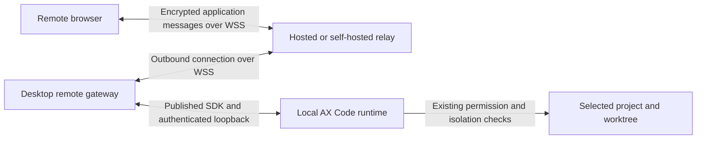

# AX Code remote control: decision and delivery package

Date: 2026-10-17
Product: AX Code
Implementation checkout: `~/code/ax-code-desktop`
Status: Proposed architecture and implementation plan. No remote service, product feature, policy relaxation, or release has been implemented by this work.

## Recommendation

Build remote control as a feature of the AX Code desktop app. Use an application relay as the default transport, with a free hosted service and a self-hosted deployment of the same relay implementation. Keep the coding runtime local and authoritative. Treat Headscale as an optional private-network deployment choice after the first relay path is qualified.

The product interaction should resemble Kimi's remote control: explicitly enable access on the development machine, pair a remote device, authenticate, and use a phone browser to inspect and direct local sessions. Do not transplant Kimi's generic HTTP/WebSocket tunnel or its credential model. Preserve AX Code's streaming, durable admission, permission checks, and approval identity.

This is an architectural recommendation, not a claim that a relay is automatically safer than a VPN. A public relay also needs tenant isolation, authenticated endpoints, resource limits, and an explicit frontend-delivery trust model.

## User intent and recommendation status

| Item                                                                   | Status in this package                                                                      |
| ---------------------------------------------------------------------- | ------------------------------------------------------------------------------------------- |
| Product name is AX Code; desktop source is in `ax-code-desktop`        | Explicit user instruction                                                                   |
| Investigate `.internal/reference` projects and remote access practices | Completed source review                                                                     |
| Consider `~/code/headscale`                                            | Evaluated, including hosted Headscale and bring-your-own Headscale                          |
| Put the feature in the desktop checkout                                | User preference; reflected in the proposed ownership                                        |
| Offer free hosted connectivity and allow self-hosting                  | User-proposed product requirement; included in the plan                                     |
| Prefer an application relay over mandatory Headscale                   | Recommended direction after the comparison; formal decision still needs the PRD/ADR process |
| Write comprehensive plans and reports here                             | Authorized and fulfilled by this package                                                    |
| Implement, deploy, create cloud resources, change DNS, or publish      | Not requested by this documentation task                                                    |

## Reading order

1. [Reference review](REFERENCE-REVIEW.md): reference projects, Kimi implementation findings, Headscale comparison, and source provenance.
2. [Architecture and security](ARCHITECTURE-AND-SECURITY.md): ownership, trust boundaries, pairing, credentials, remote operations, and recovery.
3. [Implementation plan](IMPLEMENTATION-PLAN.md): phases, proposed source locations, dependency gates, deliverables, and acceptance criteria.
4. [Validation and operations](VALIDATION-AND-OPERATIONS.md): test matrix, proposed performance budgets, free-service limits, self-hosting, rollout, and rollback.
5. [Source snapshot](evidence/source-snapshot.json) and [Kimi probe results](evidence/kimi-transport-probe-result.json): machine-readable evidence for this package.

The [Kimi probe script](evidence/kimi-transport-probe.cjs) is a local investigation harness. It does not implement remote control or exercise real accounts.

## Proposed system

Both browser and desktop connect outbound to the relay. The relay routes bounded encrypted frames. It must not execute tools or hold the local runtime password. The desktop gateway authenticates the paired device, authorizes the requested action and target, and then invokes the existing local runtime contract.

Browser payload encryption has an important limit: the browser downloads its application code from an origin. A malicious application-delivery operator could replace that code. The proposed privacy claim therefore distinguishes an untrusted forwarding service from trusted client delivery. Stronger protection against a malicious client-code publisher needs a separately trusted client or verified bootstrap and is a decision gate, not an assumed property.

## Product scope

The first usable version supports one owner per desktop installation, explicitly selected existing projects, session progress, bounded diff viewing, ordinary prompt/follow-up submission, exact pending approval responses, and interruption of a selected turn. Multiple paired personal devices are supported within service limits.

Initial remote scope excludes arbitrary shell/PTY access, arbitrary file browsing, repository creation/deletion, changing provider credentials, permission-policy editing, installing plugins, increasing budgets, merging, deploying, publishing, public session sharing, and autonomous cross-project management. A prompt still goes through the normal runtime tool and permission system; submitting it grants no additional tool access.

Hosted and self-hosted modes use the same protocol and released relay artifact. Self-hosting must not silently depend on the hosted AX Code service for routing or identity. Updating either relay or desktop must negotiate compatible protocol capabilities.

## Current source constraints

- The desktop app already has a web/API utility process, a runtime supervisor, and a per-boot internal runtime credential. Those are integration points, not an existing remote-control feature.
- Desktop server startup and AX Code's listener, attach command, and SDK currently enforce local-only access. A remote gateway is a new access boundary even when its final hop is loopback.
- Desktop code must use the published SDK and a pinned signed runtime. It must not import sibling runtime source, duplicate an agent engine, or invent an enterprise audit product.
- Accepted portfolio/process decisions cannot be reused as authorization to introduce a second general API proxy or a new always-on agent daemon. The remote connector needs an explicit ADR and lifecycle contract.
- A window closing, an app quitting, and a host sleeping are distinct events. Version one must preserve the existing app/runtime ownership rather than promise execution after app exit or host sleep.

## Evidence status

| Evidence                                                                                 | Status                                                                       |
| ---------------------------------------------------------------------------------------- | ---------------------------------------------------------------------------- |
| Relevant reference implementations and desktop boundaries                                | Inspected locally; source hashes and revisions recorded                      |
| Four isolated Kimi transport behaviors                                                   | Reproduced by the included harness; see the result receipt                   |
| Kimi upstream dependency-backed test suite                                               | Not run; reference checkout has no installed package dependencies            |
| Kimi cloud authorization and production relay                                            | Not audited or exercised; implementation not found in the reference checkout |
| AX Code remote implementation, cryptographic interoperability, or platform qualification | Not implemented or tested                                                    |
| Hosted service capacity, availability, bandwidth cost, or public onboarding              | Not measured                                                                 |

## Decisions required before implementation

| ID  | Decision                                                                           | Required output                                                      |
| --- | ---------------------------------------------------------------------------------- | -------------------------------------------------------------------- |
| D01 | New remote access boundary and exact desktop/runtime ownership                     | Accepted PRD and ADRs in affected repositories                       |
| D02 | Cryptographic protocol, maintained implementation, and client-delivery trust model | Reviewed protocol/specification, dependency and test-vector evidence |
| D03 | Hosted identity and self-hosted identity integration                               | Verified available identity contract; no invented AX Trust API       |
| D04 | Durable mutation identity, actor correlation, approval binding, and recovery       | Capability matrix and additive runtime/SDK changes where necessary   |
| D05 | Relay package/repository owner and deployable artifact                             | Accepted ownership decision and reproducible build target            |
| D06 | Free-service resource policy and initial operating envelope                        | Capacity receipts and explicit device/traffic/concurrency limits     |
| D07 | Secret storage and app/window/host lifecycle behavior on supported platforms       | Platform contract and qualification matrix                           |

These gates are required work items in the implementation plan. Drafting this package does not mark them accepted.
