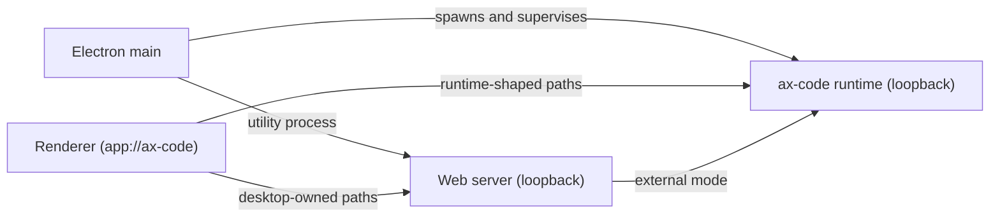

# AX Code Desktop workspace

This directory holds the source for AX Code Desktop, the desktop UI for [AX Code](https://github.com/defai-digital/ax-code):
chat sessions, supervision across projects, file review, diffs, Git, terminals, scheduled tasks and project notes.

> [!NOTE]
> To install, update or check platform support for the signed app, see the [repository README](../README.md).
> To set up a development checkout, see [CONTRIBUTING.md](./CONTRIBUTING.md).

## Features

### Chat and sessions

- Run AX Code chat sessions in a full workspace UI.
- Branch, fork, undo and redo conversation turns.
- Queue messages and keep long-running sessions visible.
- Use plan/build workflows and project notes.
- Open mini-chat windows for focused work on one session.

### Supervision and navigation

- **Workspace** opens the current conversation.
- **Portfolio** opens Mission Control over the existing project and session state, showing what needs you. Mission
  Control can also pop out into its own window.
- **Session views** offers the session grid; **Review changes** opens the current project's changes.
- The new-session page lists Projects before starter suggestions. Three starters show at first; **Show more** reveals
  the rest, including project starters.
- Sidebar directory labels add distinguishing suffixes when names collide; the full path is available on hover and in
  accessible action names.
- A **Retrying** state on a supervision row reflects a retry reported by the runtime. It does not change the run's
  urgency or count as a new approval request.

The right project sidebar and the inspector share space: opening the sidebar temporarily hides the inspector but keeps
its editor; opening a tool reveals the inspector again. In narrow windows the tool takes the full content width and
**Back to conversation** returns through the unsaved-file guard. Wider windows also offer **Focus panel** and
**Restore split view**. None of these display changes discard the current message draft.

### Git and GitHub

- Stage files, commit, push, pull, merge and rebase.
- Review diffs with inline or stacked views.
- Manage branches and worktrees.
- Create pull requests with generated descriptions.
- Recover from merge/rebase conflicts with guided UI state.
- Diffs, patches and partial commits stay inside the repository and the files you selected; a symlinked folder that
  points outside the repository is not followed.

### Files and terminal

- Browse and edit workspace files.
- Inspect large diffs without loading the whole workspace at once.
- Run integrated terminal sessions per project directory. Deleting a session stops its shell, on Windows too.
- Keep project actions and dev servers close to the chat context.

### Scheduled tasks

Open **Scheduled** from the sidebar calendar button. An empty list explains scheduling and offers **New scheduled
task**; with several projects, choose the project before editing.

- Each task shows its recurrence, timezone and next-run or stopped state, even while its actions are open.
- **More actions** provides Run now, Pause/Resume, Edit, Run history and Delete, depending on the task's state.
  Completed one-time tasks must be rescheduled rather than resumed.
- The editor starts with the task name and prompt, then schedule and execution settings. Check **Schedule summary**
  (wall-clock times, timezone, automatic-run state and missed-run policy) before saving.
- Tasks run on this computer, which must be awake with AX Code running. Actual next-run times and history come from
  the runtime; the summary describes the configured schedule.
- An unchanged imported cron schedule is kept when only the prompt is edited.
- Tasks saved by older Desktop versions move to the runtime at startup. If the runtime's task list cannot be read,
  the move waits for the next start so no task is created twice.

### Desktop shell

- Native windows on macOS Apple Silicon, Windows x64 and Ubuntu Desktop 24.04+ (amd64/arm64).
- Multi-window workflows, deep links, tray and menu actions.
- In-app updates through **AX Code → Check for Updates**.
- Project browser with [WebMCP page tools](../docs/webmcp-page-tools.md) so the agent can use the web app you are
  building.

## Architecture

### Packages

| Package               | Purpose                                                                          |
| --------------------- | -------------------------------------------------------------------------------- |
| `packages/ui`         | Shared React UI, stores, hooks and components (`@openchamber/ui`)                |
| `packages/web`        | Vite entrypoints and the loopback Express server for local file/Git/terminal APIs |
| `packages/electron`   | Electron main and preload processes, native integration and packaging            |
| `packages/akitty-web` | In-app terminal library                                                          |
| `packages/docs`       | User documentation source (MDX); not a workspace package                         |
| `shared`              | Small cross-package contracts, catalogs and environment-neutral helpers          |
| `scripts`             | Tools spanning desktop packages, including generators and docs validation        |

Directory and test ownership rules are in [repository layout](../docs/repository-layout.md); import rules are in
[project boundaries](./docs/PROJECT_BOUNDARIES.md).

### Process model



- The Electron main process spawns and supervises the ax-code runtime, in development and packaged builds alike, and
  boots the web server in a utility process in parallel. The web server treats the runtime as external and never
  spawns its own. Set `AX_CODE_DESKTOP_SUPERVISE_RUNTIME=0` to fall back to web-supervised mode.
- Packaged renderers load from the privileged `app://ax-code` scheme. Its handler routes API calls with a
  longest-prefix table (`packages/electron/src/api-prefix-router.js`): runtime-shaped paths go straight to the
  runtime, desktop-owned paths go to the web server. In `pnpm run dev`, the Vite proxy uses the same table.
- Every server binds to loopback only.

How Desktop resolves and pins the runtime and SDK is in [AX Code integration](./docs/AX_CODE_INTEGRATION.md).

## Standalone web runtime (development only)

`packages/web` is the UI substrate for development and packaging. It also runs on its own for diagnostics, but it is
not a supported end-user distribution. From the repository root:

```bash
pnpm install
pnpm run build
pnpm --filter ax-code-desktop run start -- --ui-password your-password
```

It prefers `http://localhost:3100` and scans upward if that port is busy. CLI options are in the
[web runtime README](./packages/web/README.md).

## Legacy names

The product name is **AX Code Desktop**; the installed application is **AX Code**. Some package names
(`@openchamber/ui`), storage keys, endpoint paths, CLI aliases and config directories (`~/.config/openchamber`) still
use `openchamber` so existing installs and migrated data keep working. Treat those as compatibility details, not as
the public product identity in new docs, releases or UI copy.

## License

[Apache License 2.0](./LICENSE). AX Code Desktop is maintained by DEFAI Private Limited.

Portions derived from OpenChamber remain under the [MIT License](./LICENSE-MIT). Upstream attribution is kept in
[NOTICE](./NOTICE).
